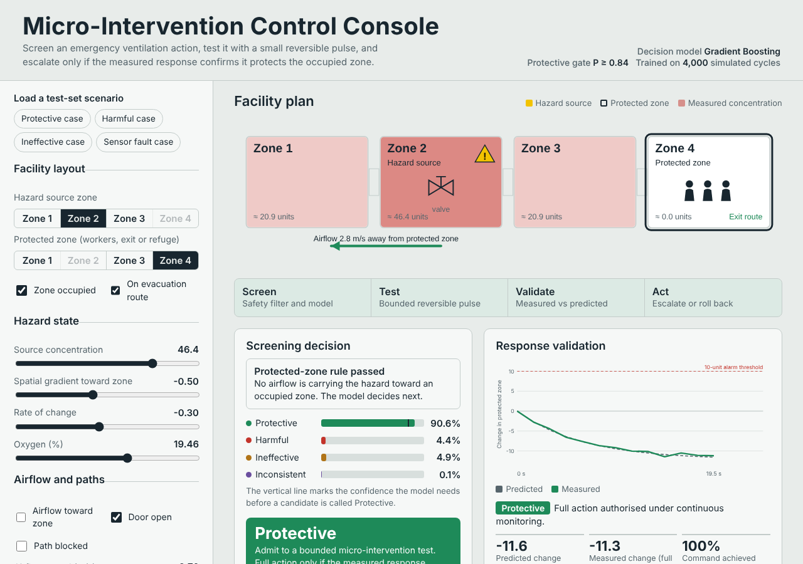

# Risk-Constrained Emergency Control with Reversible Micro-Interventions

[](https://github.com/Samvibhanshu/Risk-Constrained-Emergency-Control-System/actions/workflows/ci.yml)

In an emergency (here: a hazardous gas spreading through a building), the obvious action can make things worse.
Pushing air the wrong way carries the hazard onto the people you are trying to protect. This project is the
software for a different approach: **try a small action that can be undone, measure what it does, and only then
commit to the full action.** Before even the small test, a classifier screens the candidate and rejects the ones
that look harmful.

It is the machine-learning and control layer of the patent application *Risk-Constrained Emergency Control via
Reversible Micro-Interventions* (published 2026). Python, scikit-learn, and a browser demo that runs the same model.

**[Try the demo](https://samvibhanshu.github.io/demos/emergency-control/)**: pick a scenario, see the screening decision,
run the micro-intervention test and watch the actuator's trust update.



pip install -r requirements.txt -r requirements-dev.txt     # Python 3.12 or newer; versions pinned
pip install -r requirements.txt -r requirements-dev.txt
python -m pytest -q        # 37 tests, about 1.5 minutes (one of them re-runs the whole experiment)
python train_eval.py       # regenerate data/ and outputs/ (about 1.5 minutes on 2 cores)
python predict.py          # screen one example candidate
python export_model.py     # re-export the model for the browser demo
```

## How a decision is made

```
candidate action ──► hard rule ──► classifier + safety gate ──► small reversible test ──► measured response
                     (occupied zone     Protective only if            (a short pulse)          confirms it?
                      + airflow          P(Protective) ≥ τ                                    yes: escalate
                      toward it:                                                               no:  roll back,
                      reject)                                                                       lower trust
```

1. **Hard rule first.** If the protected zone is occupied and the airflow already moves toward it, the action is
   rejected whatever the model says. Some rules should not be learned.
2. **Classifier.** Predicts whether the action will be **Protective, Harmful, Ineffective or Inconsistent** from what is
   known *before* acting: zone layout, hazard concentration and gradients, airflow, doors, faults, the actuator and its
   trust score.
3. **Safety gate.** The model only says Protective when P(Protective) ≥ τ. Otherwise it falls back to the most likely
   other class. Calling a harmful action safe is far worse than delaying a good one, so τ is set to keep that error
   (the **false-safe rate**) at or below 1%.
4. **Test, then act.** Even a Protective action is first tried as a small pulse; only a measured improvement authorises
   the full action. Every test updates the actuator's trust (×1.04 protective, ×0.95 ineffective, ×0.85 harmful,
   ×0.59 inconsistent).

## Results

5,000 simulated decision cycles, stratified 80:20 split (4,000 train, 1,000 test), seed 42.

| Model | Accuracy | Harmful recall | False-safe rate | Gate τ | Without the gate: accuracy / false-safe |
|---|---|---|---|---|---|
| **Gradient Boosting (selected)** | **77.1%** | **92.9%** | **0.76%** (3 of 396) | 0.84 | 80.8% / 2.02% |
| Logistic Regression | 77.3% | 90.4% | 0.76% | 0.85 | 79.7% / 3.79% |
| Random Forest | 77.0% | 92.7% | 1.01% | 0.69 | 80.5% / 1.77% |

The models are chosen by **lowest false-safe rate, then highest harmful recall, then F1**, not by accuracy. For the
selected model the gate costs 3.7 points of accuracy and cuts the false-safe rate from 2.02% to 0.76%; that is the trade
it is meant to make.

On the test set, the control layer: 61 actions admitted as Protective (3 of them were actually harmful), 436 rejected as
Harmful; 72.0% of harmful cases were flagged before the protected-zone rise crossed a 10-unit alarm threshold; rollback
succeeded in 399 of 552 eligible cases (72.3%). Every number is in `outputs/results_summary.json`.

## What the tests check

| File | What it proves |
|---|---|
| `test_leakage.py` | The post-intervention measurements (`dC_protected`, `command_achievement_pct`) and the label never reach the model: not in the feature list, not in the saved pipeline, and shuffling them does not change a single prediction. It also shows why this matters: a small tree that sees them scores over 97%. |
| `test_tuning.py` | τ is the smallest threshold whose out-of-fold false-safe rate on the training data is ≤ 1%; it does not change when every test row is altered; in a full run each of the three models was tuned on the 4,000 training rows and none of the 1,000 test rows. |
| `test_gate.py` | Protective only at P ≥ τ, even when Protective is the most likely class; raising τ only ever removes Protective decisions; class order does not matter. |
| `test_reproducible.py` | Re-running the whole experiment selects the same model and τ, reproduces the selected model's metrics and the control-layer counts exactly, and the README's headline numbers. |
| `test_simulate.py` | Same seed, same data; the committed dataset is exactly what the generator produces; every label follows the rules, including each boundary (45% achievement, a rise of 6, a rise of 1 toward the zone, a fall of 5). |
| `test_predict.py` | The hard rule rejects before the model is touched; a gated decision agrees with τ; the saved model matches the summary. |
| `test_browser_model.py` | The exported model and the browser's JavaScript give scikit-learn's probabilities to 1e-12, and the same decisions. |

**A bug the browser test found.** scikit-learn's decision trees compare features as 32-bit floats; the exported
JavaScript compared 64-bit numbers. When a value fell between the two, the browser took the other branch: 27 of 5,000
random inputs got different probabilities (by up to 0.16). None of those changed a decision in that sample, but a safety
demo should not disagree with its model at all. `model.js` now rounds each input with `Math.fround`, and the test checks it.

## Design decisions

- **Leakage is the main risk.** The label is computed from what happens *after* the action, so any post-action column
  among the inputs would make the model look near-perfect and be useless in practice. The excluded columns live in one
  list (`train_eval_utils.LEAKAGE`) used by training, prediction and the tests.
- **The test set is touched once.** τ is tuned with 5-fold out-of-fold predictions on the training split only.
- **Versions are pinned.** A pickled scikit-learn model is only safe to load with the version that wrote it, and newer
  versions moved the Random Forest by a few test records. `requirements.txt` pins the exact versions that produced `outputs/`.
- **One model, two runtimes.** `export_model.py` writes the trees as JSON and refuses to write them unless they reproduce
  scikit-learn's probabilities, so the demo needs no server.

## Layout

```
simulate.py           dataset generator and the labelling rules
train_eval_utils.py   leakage list, safety gate, false-safe rate, τ tuning, hard rule (shared by everything)
train_eval.py         the experiment: split, train three models, tune, select, control-layer analysis, figures
predict.py            screen one candidate          export_model.py   model → JSON for the browser
app/                  browser demo (index.html, model.js, model_export.js)
data/  outputs/       generated dataset, results, figures, the selected model
tests/                37 tests
```
